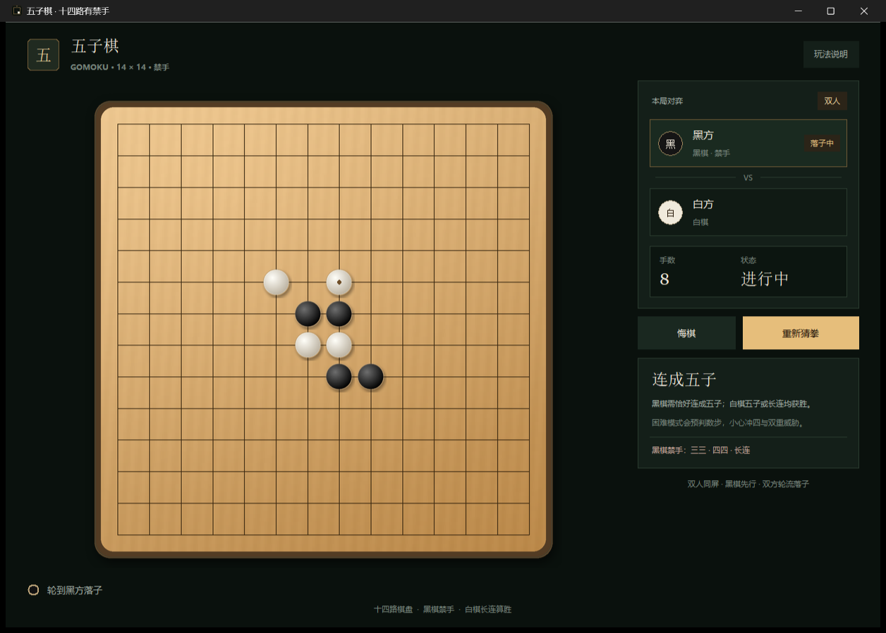

# AI_Generated

> Something created by AI. I don't know whether they are usefull or not. Ahh, just put them on the repository.

---

# 五子棋 · 十四路有禁手

一个 Windows 桌面五子棋（14×14，黑棋禁手、白棋长连算胜），带简单 / 中等 / 困难三档 AI。
本仓库同时包含：

- **桌面版**：Tkinter + Pillow，单文件 EXE；
- **网页版**：纯 HTML/CSS/JS，双击即可玩；
- **校验脚本**：规则差分测试、增量结构 fuzz、AI 战术用例、性能基准。



---

## 直接运行（下载即用）

1. 下载本仓库：`Code → Download ZIP`，或 `git clone`。
2. 进入 `五子棋桌面版/`，双击 **`五子棋.exe`**。
3. 首次启动会把内置运行库解压到**当前目录**下的 `_MEIxxxxx`，需要几秒钟；正常退出会自动清理。
4. 若 Windows 提示“未知发布者”，选择“更多信息 → 仍要运行”。

> **运行目录必须可写。** 本版本用 `--runtime-tmpdir "."` 打包，运行时解压目录是程序当前目录，而不是 `%TEMP%`。这样可以避免在沙箱/安全软件禁止写 `%TEMP%` 时出现
> `Could not create temporary directory!`。请把 EXE 放在普通可写文件夹中双击，不要从只读目录或压缩包内直接运行。
>
> 如果程序被强制结束，可能残留一个 `_MEIxxxxx` 文件夹，直接删除即可。

**文件校验（可选）**

```text
SHA256  五子棋.exe  F2A87FB17C784B1DB0FC7E75C80507FFC03E05335A8757568A9509E5953A92C0
```

---

## 仓库结构

```text
.
├─ 五子棋桌面版/            Windows 桌面版
│  ├─ 五子棋.exe            可直接运行的单文件程序
│  ├─ main.py               Tkinter 界面与对局流程
│  ├─ engine.py             规则、禁手、胜负判定、三档 AI
│  ├─ engine_v1_backup.py   优化前的引擎（用于对照/回退）
│  ├─ build.ps1             重新打包脚本
│  ├─ requirements.txt      Pillow / PyInstaller
│  ├─ README.md             桌面版说明
│  ├─ preview-desktop.png   预览图
│  └─ 性能优化报告.md        问题清单、优化内容、实测数据
├─ web-version/             纯前端网页版
│  ├─ index.html
│  ├─ app.js
│  ├─ engine.js
│  └─ styles.css
└─ verification/            规则/性能校验脚本
   ├─ README.md
   ├─ test_rules.py
   ├─ compare.py
   ├─ root_compare.py
   ├─ test_ctx.py
   ├─ tactics.py
   ├─ match.py
   ├─ smoke_gui.py
   ├─ final_bench.py
   ├─ hard_compare.py
   ├─ fixed_depth.py
   ├─ ab_score.py
   ├─ patterns.py
   ├─ multiplicity.py
   ├─ run_rules_v2.py
   ├─ engine_v1.py
   └─ engine_v2.py
```

---

## 功能与规则

- **14 × 14 棋盘**，黑棋先行，双方轮流落子。
- **人机对弈**：猜拳决定先后手；简单 / 中等 / 困难三档 AI。
- **双人同屏**：同一位玩家交替执黑执白。
- **完整禁手**：黑棋禁止 **三三、四四、长连**；白棋无禁手。
- **五连优先**：黑棋一手同时成五并形成禁手时，按“五最大”判黑胜。
- **白棋长连算胜**。
- 胜利连线高亮、禁手红色 × 反馈、最后一手标记、Ctrl+Z 悔棋、F2 设置、Esc 关闭弹窗。

规则参考：

- [RIF International Rules of Renju](https://mail.renju.net/rifrules/)
- [台湾五子棋协会：禁手](https://www.renju.org.tw/teach/teach018.htm)

---

## 性能优化（相对旧版引擎）

| 项目 | 旧版 | 新版 | 提升 |
| --- | ---: | ---: | ---: |
| 黑棋禁手判定（182 个空点） | 21.31 ms | 1.48 ms | **14.4×** |
| `get_candidates` | 182 µs | 48 µs | **3.8×** |
| 单点快速评分 × 182 | 1.64 ms | 0.41 ms | **4.0×** |
| 固定深度 4 搜索（同局面） | 377.2 ms | 56.7 ms | **6.65×** |
| 困难模式同 1.15 s 节点数 | 485 | 2,871 | **5.9×** |
| 中等难度（同一局面） | 9.6 ms | 6.4 ms | 1.5× |

困难模式改为**迭代加深 + Zobrist 置换表**，1.15 秒内可完整搜到 root+5；搜索支持取消，重开/悔棋会立即停止旧 AI 线程。

实现要点：预计算方向射线、封顶 6 的胜负判定、严格保守的禁手快速门控、增量邻居计数、增量“成五点”集合、点评分查表化。规则语义保持不变，75,912 个“空点 × 执子方”组合与旧引擎差分 **0 差异**。

完整数据、验证方法和后续建议见
[`五子棋桌面版/性能优化报告.md`](五子棋桌面版/性能优化报告.md)。

---

## 从源码运行

环境要求：Windows、Python 3.10+（本项目使用 3.14）、Pillow。

```powershell
cd 五子棋桌面版
python -m pip install -r requirements.txt
python main.py
```

> `requirements.txt` 中的 PyInstaller 只在重新打包时需要；仅运行游戏装 Pillow 即可。

---

## 重新打包 EXE

```powershell
cd 五子棋桌面版
powershell -ExecutionPolicy Bypass -File .\build.ps1
```

`build.ps1` 使用 PyInstaller 单文件模式，并带有：

```text
--runtime-tmpdir "."
```

这样生成的 EXE 会把 `_MEIxxxxx` 解压到当前目录，不依赖 `%TEMP%`。

---

## 网页版

直接用浏览器打开 `web-version/index.html` 即可，无需服务器、无需联网。

---

## 校验脚本

```powershell
cd verification
python test_rules.py        # 规则表驱动用例
python compare.py           # 新旧引擎 75,912 组合差分
python root_compare.py      # 固定深度根评分差分
python test_ctx.py          # 增量邻居/成五点/哈希 fuzz
python tactics.py           # AI 成五/挡四/合法性
python final_bench.py       # 新旧引擎性能对比
```

说明见 [`verification/README.md`](verification/README.md)。脚本默认假设自己位于仓库根目录下的 `verification/`，并通过 `../五子棋桌面版` 找到引擎。

---

## 已知限制

- 棋盘是 **14×14**，不是标准连珠 15×15；这是本项目从网页版延续下来的设计。
- 双三 / 双四采用常见“活三延伸、冲四、同线多四”判定；职业规则中极少数需要多层递归验证的“伪三”会简化。
- 终局后不能悔棋（`phase == "over"` 时 Ctrl+Z 无效）。
- 未声明高 DPI 感知，Windows 125% / 150% 缩放下界面可能略糊。
- 困难模式每步最多思考 1.15 秒；想更快可调小 `engine.HARD_TIME_LIMIT`。

---

## 说明

个人学习项目，未附开源许可证；转载请注明出处。
