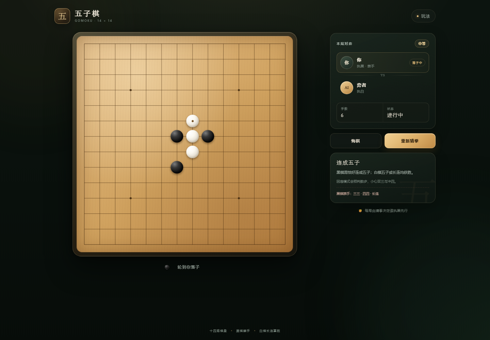

# 五子棋 · 十四路有禁手

一个打开即玩的 **14 × 14 有禁手 PvE 五子棋**，无需安装依赖，全部逻辑运行在浏览器本地。

## 开始游戏

双击 `index.html` 即可（推荐 Edge / Chrome）。

打开后：

1. 选择 **简单 / 中等 / 困难** 三档 AI 难度；
2. 与 AI 猜拳，**赢家执黑先行**，平局自动重猜；
3. 点击棋盘交叉点落子。黑棋必须恰好连成五子；白棋连成五子或长连均获胜。

## 功能

- **14 × 14 棋盘**：横、竖、斜任意方向对局。
- **完整禁手限制**：黑棋禁止 **三三、四四、长连**，玩家与 AI 都必须遵守。
- **五连优先**：黑棋一手同时成五并形成禁手时，按“五最大”判黑胜。
- **白棋无禁手**：白棋可以自由形成三三、四四，长连同样算胜。
- **猜拳定先手**：石头、剪刀、布；赢家执黑，平局可立刻再猜。
- **三档 PvE AI**
  - 简单：随性落子，偶尔会漏看杀招，适合热身；
  - 中等：会识别冲四、活三，主动进攻与防守；
  - 困难：基于 Alpha-Beta 搜索预判后续变化，并在搜索中排除禁手落点。
- **禁手反馈**：点击禁手点时显示红色标记并说明禁手类型，落子不会生效。
- **对局辅助**：手数、当前回合、最近落子标记、胜利连线高亮。
- **悔棋**：轮到你时，可回退自己上一手及 AI 的应手。
- **重新猜拳**：每局重新决定先后手；在对局中打开设置后，可点右上角关闭返回。
- **响应式布局**：桌面端与手机端均可游玩。

## 文件说明

| 文件 | 作用 |
| --- | --- |
| `index.html` | 页面结构 |
| `styles.css` | 视觉样式与响应式布局 |
| `app.js` | 猜拳流程、对局状态与界面交互 |
| `engine.js` | 棋盘规则、禁手判定、胜负判断与三档 AI |
| `preview.png` | 对局预览图 |

## 规则细节

- 棋盘为 14 行 × 14 列，黑棋先行，双方交替落子。
- 黑棋必须 **恰好五连** 才能获胜；黑棋的六连及以上属于 **长连禁手**，不能落子。
- 黑棋禁止 **双活三（三三）**、**双四（四四）** 与 **长连**。
- 黑棋落子同时成五并形成禁手时，**五最大**，判黑胜。
- 白棋没有禁手；白棋五连或长连均获胜。
- 禁手落点会被拒绝，并显示“三三禁手 / 四四禁手 / 长连禁手”等提示。
- 本程序只启用常见禁手，不限制黑棋首着位置，也不采用职业连珠的完整开局规则。
- 棋盘下满且无人获胜时判平局。

> 本程序采用常见有禁手规则。双三、双四的判定覆盖常见的活三延伸、冲四与同线多四情况；职业连珠中极少数需要多层递归判断的“伪三”特例未纳入。

## 规则参考

- [RIF International Rules of Renju](https://mail.renju.net/rifrules/)
- [台湾五子棋协会：禁手](https://www.renju.org.tw/teach/teach018.htm)

## 小提示

困难模式会搜索 AI 自己与玩家的后续落点，并在生成候选着法时剔除禁手。想轻松一点，可以先从简单模式熟悉棋盘。
