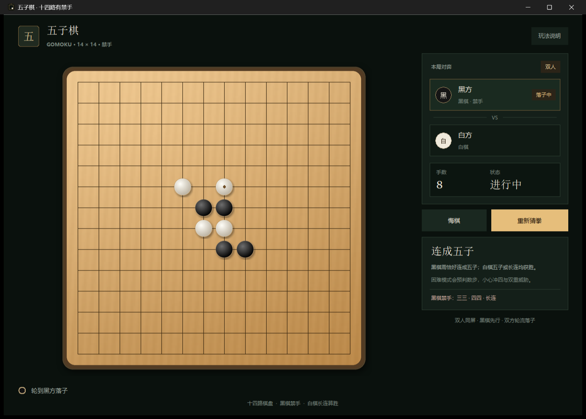

# 五子棋 · 十四路有禁手（桌面版）

一个完全脱离浏览器和 HTML 的 Windows 桌面五子棋。单文件 EXE，无需安装 Python，双击即可运行。

支持两种玩法：

- **人机对弈**：猜拳定先手，对战三档 AI。
- **双人同屏**：同一位玩家交替执黑执白，按回合轮流落子，结算显示“黑胜”或“白胜”。



## 运行

双击 **`五子棋.exe`** 即可。

- 适用于 Windows 10 / 11 64 位。
- 首次启动会解压内置运行库，可能需要几秒钟。
- 若 Windows 提示“未知发布者”，选择“更多信息 → 仍要运行”即可。
- 程序完全离线，不需要浏览器、网络或 Python 环境。
- 本版本把单文件运行时解压目录设为**程序当前目录**，避免 `%TEMP%` 被安全软件或沙箱禁用时出现 `Could not create temporary directory!`。请把 EXE 放在可写目录中，并从该目录启动。

## 操作

- **鼠标左键**：在棋盘交叉点落子。
- **Ctrl + Z**：悔棋。
  - 双人同屏：每次撤销一手；
  - 人机对弈：撤销自己上一手及 AI 的应手。
- **F2**：打开设置，切换模式或重新开局。
- **Esc**：关闭当前设置 / 玩法 / 结果窗口。

## 功能

- **两种模式**：人机对弈 / 双人同屏，可在开局设置中切换。
- **14 × 14 棋盘**，黑棋先行，双方轮流落子。
- **双人同屏**
  - 玩家同时控制黑棋和白棋，按回合交替落子；
  - 黑棋禁手、白棋长连获胜等规则完整生效；
  - 结束后显示“黑胜”或“白胜”。
- **人机对弈**
  - 猜拳决定先后手：石头、剪刀、布；赢家执黑，平局自动重猜；
  - 简单 / 中等 / 困难三档 AI；
  - 困难模式使用 Alpha-Beta + 迭代加深 + 置换表搜索，并会排除禁手落点；
- **完整禁手规则**：黑棋禁 **三三、四四、长连**，玩家与 AI 都必须遵守。
- **五连优先**：黑棋一手同时成五并形成禁手时，按“五最大”判黑胜。
- **白棋无禁手**：白棋可以自由形成三三、四四，长连同样算胜。
- **禁手反馈**：点击禁手点时棋盘显示红色 ×，状态栏提示具体禁手类型，落子不会生效。
- **胜利结算**：胜利连线高亮、连珠棋子描边、结果窗口。
- **对局信息**：手数、当前回合、双方执色、最近落子标记。
- **纯格子棋盘**：棋盘只保留 14 × 14 网格，不显示木纹刻线、星位等多余线条。
- **原生桌面界面**：自绘木纹底色、抗锯齿棋子、深色窗口、可随窗口缩放。

## 规则说明

- 黑棋必须 **恰好五连** 才能获胜；六连及以上属于长连禁手。
- 黑棋禁止双活三、双四、长连；白棋没有禁手。
- 黑棋同时成五与形成禁手时，五最大，判黑胜。
- 双人同屏模式没有猜拳环节，直接由黑棋先行。
- 本程序只启用常见禁手，不限制黑棋首着位置，也不采用职业连珠的完整开局规则。
- 双三、双四采用常见活三延伸、冲四及同线多四判定；职业赛事中极少数需要多层递归判断的“伪三”特例会有所简化。

规则参考：

- [RIF International Rules of Renju](https://mail.renju.net/rifrules/)
- [台湾五子棋协会：禁手](https://www.renju.org.tw/teach/teach018.htm)

## 文件

| 文件 | 说明 |
| --- | --- |
| `五子棋.exe` | 可直接运行的 Windows 单文件程序 |
| `main.py` | Tkinter 桌面界面、模式与对局流程 |
| `engine.py` | 棋盘规则、禁手判定、胜负判断与三档 AI |
| `assets/gomoku.ico` | 程序图标 |
| `build.ps1` | 重新打包 EXE 的脚本 |
| `requirements.txt` | 打包依赖 |
| `preview-desktop.png` | 双人同屏模式截图 |

## 从源码运行 / 重新打包

环境要求：Windows、Python 3.10+（本项目使用 3.14）。

```powershell
python -m pip install -r requirements.txt
python main.py
```

重新生成单文件 EXE：

```powershell
powershell -ExecutionPolicy Bypass -File .\build.ps1
```

生成结果会复制为项目根目录下的 `五子棋.exe`。
